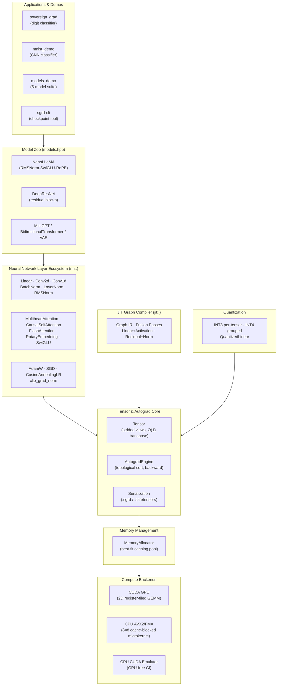
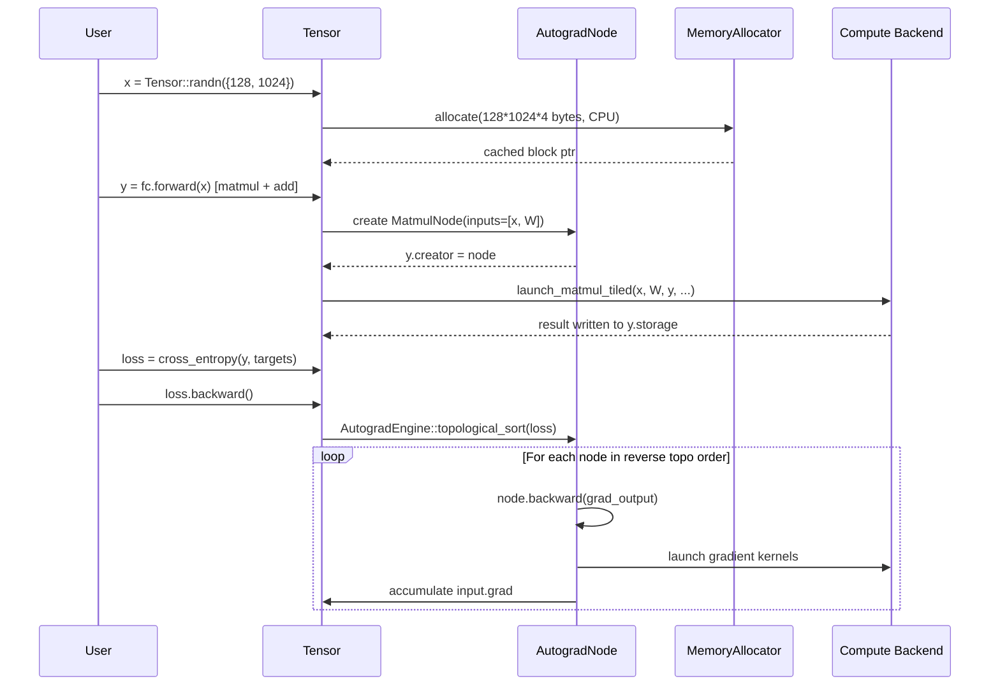
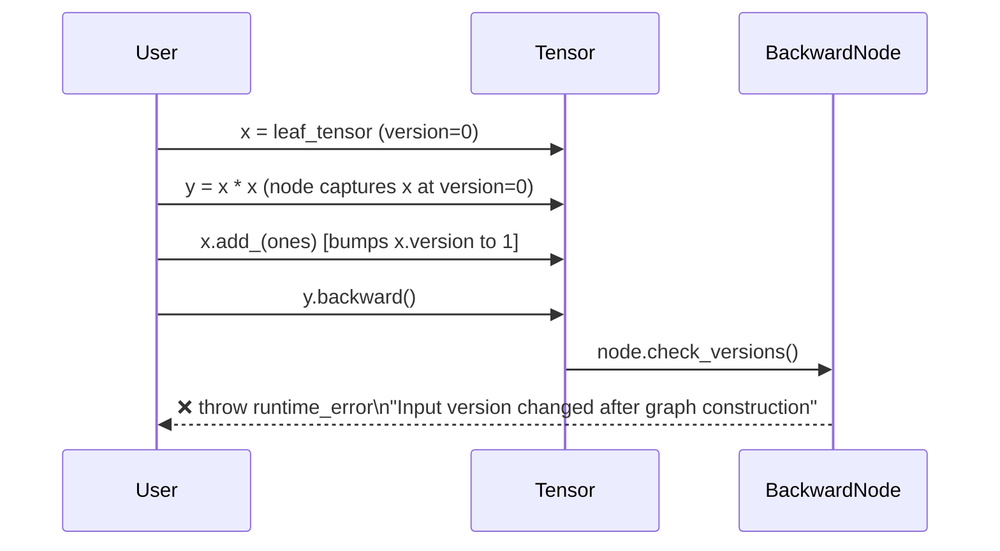

<div align="center">

# SovereignGrad

### A zero-dependency C++17 autograd engine and deep learning framework built from scratch

**Dynamic reverse-mode autograd · AVX2 SIMD kernels · CUDA 2D register tiling · Best-fit memory allocator · SafeTensors interoperability**

[](https://github.com/bharqav/soverign-grad/actions/workflows/ci.yml)
[](https://en.cppreference.com/w/cpp/17)
[](LICENSE)
[](CMakeLists.txt)
[](include/sovereigngrad/cuda_mock.hpp)

</div>

---

SovereignGrad is a zero-dependency C++17 tensor and deep learning framework with a dynamic reverse-mode automatic differentiation engine. It is designed for engineers and researchers who want a readable implementation of the systems behind modern machine learning libraries.

The project demonstrates strided tensor storage, DAG-based autograd, custom memory allocation, SIMD kernel design, serialization, quantization, and GPU compute in a compact codebase with reproducible tests and examples.

> **Project status:** SovereignGrad is an educational and experimental framework. The test suite and CI provide a strong correctness baseline, but the project is not a drop-in replacement for a mature production framework.

---

## Architecture

SovereignGrad is organized as a layered stack from raw compute primitives up to high-level model architectures.



### Forward Pass - Tensor Computation Graph



### Backward Pass - Version Guard Safety



---

## Features

| Capability | Detail |
|------------|--------|
| **Strided tensor engine** | N-dimensional multi-dimensional views over shared storage; `O(1)` zero-copy `transpose`, `slice`, `view` |
| **Dynamic autograd DAG** | Topological sort + reverse-mode backward; `retain_graph`, gradient hooks |
| **In-place mutation guard** | Version counters (`_version`) detect in-place modification during backward, throw `runtime_error` |
| **AVX2 microkernel** | 8×8 register-tiled matrix multiply with 64/128/256-byte L1/L2 cache blocking |
| **CUDA 2D register tiling** | 64×64 macro-blocks, 4×4 register tiles, zero bank conflicts |
| **CUDA CPU emulator** | Compiles `.cu` kernels as standard C++ - full test coverage on GPU-free machines |
| **Best-fit memory allocator** | Block coalescing, separate CPU/CUDA pools, peak memory telemetry |
| **Flash Attention** | Tiled SRAM computation for memory-efficient attention |
| **Rotary Position Embedding** | RoPE with precomputed cos/sin cache |
| **SwiGLU** | LLaMA/Mistral-style gated MLP |
| **JIT fusion** | Runtime graph passes: `Linear+Activation`, `Residual+Norm` |
| **INT8/INT4 quantization** | Per-tensor symmetric and grouped quantization, `QuantizedLinear` |
| **`.sgrd` serialization** | Binary checkpoint with magic header, version stamp, full `nn::Module` round-trips |
| **SafeTensors I/O** | Zero-copy HuggingFace `.safetensors` parser and writer |
| **AdamW on CUDA** | Native GPU optimizer step - zero PCIe bounce |
| **Finite-difference gradcheck** | Automated numerical validation of analytic gradients |

---

## Project Status

> **v0.1.0** - All core systems implemented and tested. Not production-hardened. See [ROADMAP.md](ROADMAP.md) for honest limitations and planned work.

---

## Quick Start

### Prerequisites

| Requirement | Minimum | Notes |
|-------------|---------|-------|
| C++ Compiler | C++17 | GCC 9+, Clang 10+, MSVC 2019+, AppleClang 12+ |
| CMake | 3.15 | |
| NVIDIA CUDA Toolkit | 11.0+ | Optional - CPU emulator used when absent |
| OpenMP | any | Optional - auto-detected |
| Python 3.8+ | - | Optional - benchmarks only (`pip install torch numpy`) |

### Build from Source

```bash
git clone https://github.com/bharqav/soverign-grad.git
cd soverign-grad

# CPU-only build (no GPU required; uses the CUDA emulator)
cmake -B build -DCMAKE_BUILD_TYPE=Release -DUSE_CUDA=OFF
cmake --build build --config Release

# With physical NVIDIA GPU
cmake -B build -DCMAKE_BUILD_TYPE=Release -DUSE_CUDA=ON
cmake --build build --config Release
```

### Run the Test Suite

```bash
# Full automated test suite (tensor basics, autograd, gradchecks, JIT, quantization, serialization)
./build/sovereign_grad_test

# Train a digit classifier (CPU + CUDA emulation)
./build/sovereign_grad

# MNIST Convolutional Network demo
./build/mnist_demo

# 5-model architecture suite (NanoLLaMA, DeepResNet, MiniGPT, BiTransformer, VAE)
./build/models_demo

# Micro-benchmark suite
./build/sovereign_grad_benchmark

# Inspect a checkpoint
./build/sgrd-cli inspect test_model_checkpoint.sgrd
```

### Docker (CUDA)

```bash
# Build with CUDA hardware support inside container
docker build -t sovereigngrad .
docker run --gpus all sovereigngrad
```

---

## Architecture Deep Dive

### Tensor Engine

The `Tensor` class is a lightweight handle over a reference-counted `TensorImpl`, which in turn holds a reference-counted `Storage` buffer. This enables:

- **`O(1)` transpose**: swaps strides, no data movement
- **`O(1)` slice / narrow / select**: adjusts offset + strides
- **Zero-copy views**: `view()` / `reshape()` return a new `Tensor` sharing the same `Storage`
- **Explicit `contiguous()`**: materializes a new contiguous buffer when needed

Strides follow row-major (C-order) convention. Device placement (`CPU` / `CUDA`) is tracked per-`Storage`.

### Autograd Engine

The engine implements dynamic (eager) reverse-mode automatic differentiation:

1. **Forward**: each differentiable operation creates a `Node` subclass that captures input `TensorImpl` pointers and their version counts at graph construction time.
2. **Version check**: on `backward()`, each `Node` calls `check_versions()` - if any input was mutated in-place after graph construction, a `runtime_error` is thrown immediately.
3. **Topological sort**: `AutogradEngine::backward` performs DFS from the loss to collect all `TensorImpl` nodes in reverse topological order.
4. **Backward sweep**: gradients flow through each `Node::backward()` in reverse order, accumulating into `.grad` tensors.

### Memory Allocator

`MemoryAllocator` maintains a flat vector of `Block` structs (pointer, size, in-use flag, device). On `allocate()`:

1. Scans for the smallest free block ≥ requested size (best-fit).
2. If found, splits the block if the remainder exceeds a minimum threshold.
3. If not found, calls `malloc` / `cudaMalloc` and appends a new block.

On `free()`, the block is marked not-in-use and `merge_free_blocks()` coalesces adjacent free blocks in a single linear scan. This eliminates OS allocation thrashing for repeated same-shape tensor allocations.

### SIMD Microkernel

The CPU matmul kernel (`simd.hpp`) computes `C = A × B` for `[M, K] × [K, N]` with:
- Outer tile loops over `[MC, KC, NC] = [64, 256, 128]` L2/L1 cache blocks
- Inner `8×8` AVX2 register kernel accumulates 8 output rows × 8 output cols simultaneously using `_mm256_fmadd_ps`
- Scalar fallback for non-AVX2 targets

### CUDA Register-Tiled GEMM

The CUDA `matmul_tiled` kernel uses:
- 64×64 shared memory tile loaded cooperatively by the thread block
- Each thread owns a 4×4 register tile of output elements
- Shared memory bank conflict elimination via column padding
- Thread coarsening to reduce scheduling overhead

### JIT Graph Compiler

The `jit::Graph` IR captures computation as a DAG of typed `Node` objects (`Matmul`, `Add`, `GELU`, etc.). Optimization passes scan the node list and rewrite matching subgraphs:

- `pass_fuse_linear_activation`: merges `Matmul → bias_add → GELU/ReLU/SiLU` into a single `FusedLinearActivation` node
- `pass_fuse_residual_norm`: merges `Add → LayerNorm/RMSNorm` into `FusedResidualNorm`

Fused nodes execute the combined forward pass in one memory sweep, reducing intermediate tensor allocations.

### Quantization

`quantization.hpp` implements weight-only compression for inference. Two schemes are provided:

| Scheme | Granularity | Bits | Use Case |
|--------|-------------|------|----------|
| Per-tensor symmetric | Whole tensor | INT8 | Fast path, single scale factor |
| Grouped symmetric | Configurable group (default 32) | INT4 | Higher fidelity, more scales |

A tensor is quantized by dividing each weight by its scale and rounding to the nearest integer within the representable range. Dequantization multiplies back. `nn::QuantizedLinear` consumes a quantized weight tensor and performs the matrix multiply in the dequantized domain, so the numerics match the floating-point path within quantization error.

The test suite asserts that the round-trip error stays below a configured tolerance for both schemes.

### Serialization

SovereignGrad writes checkpoints in two formats.

**`.sgrd` (native)** is a compact binary container documented in [`docs/SERIALIZATION_SPEC.md`](docs/SERIALIZATION_SPEC.md). It begins with a magic header and version stamp, followed by a parameter inventory (name, shape, dtype) and then the raw weight blocks. Because the layout is written and read by the same code path, `nn::Module` objects round-trip completely, including submodule structure.

**`.safetensors` (HuggingFace)** is handled by `safetensors.cpp`, which reads and writes the upstream format directly. The parser maps the JSON metadata header to tensor descriptors and then reads the data block, so files written here are consumable by the Python ecosystem and vice versa.

The `sgrd-cli` utility bridges the two (`to-safetensors`, `from-safetensors`) and can inspect, verify, or dump a checkpoint as JSON.

### CUDA Emulation

Every `.cu` source is also compiled as standard C++ when a CUDA compiler is unavailable. `cuda_mock.hpp` supplies the runtime surface (`cudaMalloc`, `cudaMemcpy`, streams, error codes) plus a `LAUNCH_KERNEL` macro that expands a grid and block specification into nested host loops over `blockIdx` and `threadIdx`.

The consequence is meaningful: the same kernel source that runs on an NVIDIA GPU also runs in CI on a GPU-free runner, so the GPU code paths are covered by the full test suite rather than by a separate mock test suite. One subtlety is that `__shared__` expands to `thread_local static`, which is sufficient for kernels that do not rely on inter-thread shared-memory synchronization.

### Verification

Correctness is enforced at four levels.

**Numerical gradchecks.** `gradcheck.hpp` compares analytic gradients against central finite differences, element by element, with configurable absolute and relative tolerances. Every differentiable operator has a gradcheck in the suite, and inputs are seeded with random values so that non-smooth operators (max pooling, for example) are exercised away from tie boundaries.

**Cross-backend equivalence.** The entire suite runs twice, once on `Device::CPU` and once on `Device::CUDA`. Comparative tests such as FlashAttention versus a naive attention reference assert that both backends agree to within tolerance, which is what catches launcher or grid-configuration mistakes that a single-backend test would miss.

**Memory-safety instrumentation.** CI runs a second build under AddressSanitizer and UndefinedBehaviorSanitizer with leak detection enabled.

**In-place mutation guard.** Version counters turn silent gradient corruption into an immediate, explicit error, and the suite asserts that the guard actually fires.

---

## Technical Design

### Engineering Decisions

**Decision**: Implement CUDA emulation instead of CPU-only fallback  
**Reasoning**: GPU code and CPU code share the same kernel dispatch surface. The emulator makes it possible to write a kernel once and run it on both hardware and CI without `#ifdef` sprawl.  
**Trade-off**: The emulator is single-threaded and slow. It exists for correctness testing, not performance.

---

**Decision**: Best-fit memory allocator over system `malloc`  
**Reasoning**: Deep learning training creates and destroys many same-shape tensors (activations, gradients) in tight loops. System `malloc` causes repeated OS round-trips. Best-fit reuse eliminates most OS interactions for steady-state workloads.  
**Trade-off**: The current linear-scan implementation is `O(n)` in pool size. For large pools (thousands of blocks), a sorted free-list or segregated bins would be faster.

---

**Decision**: Version counters for in-place mutation detection  
**Reasoning**: Silent gradient corruption from in-place modification during backward is one of the hardest bugs to diagnose in autograd implementations. Version counters make this class of bug a hard crash immediately.  
**Trade-off**: Every in-place operation increments a counter, adding one atomic write per mutation.

---

**Decision**: Separate `include/soverigngrad/` compatibility shims  
**Reasoning**: The project name was initially spelled without the 'e' (`soverigngrad`). Compatibility headers redirect to the canonical `sovereigngrad/` namespace to avoid breaking any early adopters.  
**Trade-off**: Minor namespace confusion. The `include/soverigngrad/` directory will be removed in v0.2.0.

---

### Known Performance Characteristics

The following benchmarks were measured on an AMD Ryzen 7 CPU against PyTorch (Intel MKL / oneDNN). Results reflect the actual `benchmark_results.md` in this repository.

| Operation | SovereignGrad | PyTorch | Notes |
|-----------|--------------|---------|-------|
| RMSNorm Fwd/Bwd `[128, 1024]` | **0.74 ms** | 1.15 ms | ✅ 1.56× faster - direct memory pass, no Python overhead |
| Memory Allocator `[1024×1024]` | 26.16 ms | 23.37 ms | 0.89× - comparable, includes malloc cold start |
| AdamW step (10× `[1024, 1024]`) | 111.79 ms | 61.81 ms | 0.55× - parameter loop is sequential |
| Linear Fwd/Bwd `[128, 1024]` | 94.42 ms | 6.28 ms | 0.07× - MKL BLAS dominates |
| MNIST Synthetic Training | 93.86 ms | 54.02 ms | 0.58× - full training loop |

> **Honest assessment**: SovereignGrad is competitive on small operations (norms, allocator) but significantly slower than PyTorch on matrix operations due to MKL's highly tuned BLAS vs. the custom AVX2 microkernel. The custom AVX2 kernel demonstrates the technique correctly - not competitive throughput for large matrices. See [benchmarks/benchmark_results.md](benchmarks/benchmark_results.md) for full results.

---

## Testing

The test suite (`src/test_suite.cpp`) covers:

| Test Category | What Is Tested |
|---------------|---------------|
| Tensor basics & strides | Shape, stride layout, contiguity, `O(1)` transpose |
| Memory allocator | Cache hit/miss, block coalescing, peak stats |
| In-place version guard | `add_()` after forward pass → backward throws |
| `NoGradGuard` | DAG not constructed inside guard context |
| Numerical gradchecks | Central-difference `gradcheck` for all core ops |
| Serialization | `.sgrd` save/load round-trip with parameter equality |
| SafeTensors | `.safetensors` parse/write round-trip |
| Quantization | INT8 quantize → dequantize round-trip error |
| JIT fusion | Graph optimization pass correctness |
| CUDA emulation | All tests run on `Device::CUDA` (emulated) |
| Model zoo | Forward pass + loss decrease for all 5 model architectures |

### Running Tests

Running the suite writes two checkpoint artifacts into the current working directory: `test_model_checkpoint.sgrd` from the serialization test, and `sovereign_digit_classifier.sgrd` from the demo. Both are covered by the `*.sgrd` ignore rule and are not committed. This is why the CI workflow runs the test suite before the `sgrd-cli` inspection step, which reads the fixture the suite just produced.

```bash
# Full test suite
./build/sovereign_grad_test

# With AddressSanitizer + UndefinedBehaviorSanitizer (Linux + Clang)
cmake -B build-asan -DCMAKE_BUILD_TYPE=Debug -DENABLE_SANITIZERS=ON -DUSE_CUDA=OFF
CC=clang CXX=clang++ cmake --build build-asan --config Debug
ASAN_OPTIONS="detect_leaks=1" UBSAN_OPTIONS="halt_on_error=1" ./build-asan/sovereign_grad_test

# Numerical gradcheck (runs as part of test suite)
./build/sovereign_grad_test  # prints per-op gradcheck results
```

---

## Project Structure

```
sovereigngrad/
├── include/
│   └── sovereigngrad/          # Public C++ API headers
│       ├── allocator.hpp       # MemoryAllocator, Device enum
│       ├── tensor.hpp          # Tensor, TensorImpl, Storage
│       ├── autograd.hpp        # AutogradEngine, NoGradGuard, Node
│       ├── ops.hpp             # All differentiable operators (forward declarations)
│       ├── nn.hpp              # Layer ecosystem: Linear, Conv2d, attention, optimizers
│       ├── module.hpp          # nn::Module base class
│       ├── models.hpp          # Reference architectures (NanoLLaMA, DeepResNet, ...)
│       ├── simd.hpp            # AVX2 vectorized elementwise kernels (header-only)
│       ├── cuda_kernels.cuh    # CUDA kernel launch interface
│       ├── cuda_mock.hpp       # CPU CUDA emulation layer
│       ├── cuda_stream.hpp     # CUDA stream abstraction
│       ├── jit.hpp             # JIT IR graph and fusion passes
│       ├── quantization.hpp    # INT8/INT4 quantization API
│       ├── safetensors.hpp     # SafeTensors parser/writer
│       ├── serialization.hpp   # .sgrd checkpoint API
│       ├── gradcheck.hpp       # Numerical gradient checker
│       └── mnist.hpp           # MNIST data loader helpers
│
├── include/
│   └── soverigngrad/            # Deprecated spelling, forwards to sovereigngrad/
│
├── src/
│   ├── tensor.cpp              # Tensor storage, views, device transfers
│   ├── autograd.cpp            # Node system, topological sort, backward engine
│   ├── ops.cpp                 # All operator forward + backward implementations
│   ├── module.cpp              # Module base: parameter/submodule registry
│   ├── allocator.cpp           # Best-fit caching pool
│   ├── cuda_kernels.cu         # CUDA kernel implementations (elementwise, GEMM, norms)
│   ├── jit.cpp                 # JIT graph execution and fusion passes
│   ├── quantization.cpp        # Quantization primitives
│   ├── safetensors.cpp         # SafeTensors binary format
│   ├── serialization.cpp       # .sgrd binary checkpoint format
│   ├── test_suite.cpp          # Automated test suite + numerical gradchecks
│   ├── benchmark.cpp           # Micro-benchmark suite
│   ├── main.cpp                # Digit classifier demo
│   ├── mnist.cpp               # MNIST data pipeline
│   ├── mnist_demo.cpp          # MNIST training loop
│   ├── models_demo.cpp         # 5-model demonstration
│   └── sgrd_cli.cpp            # sgrd-cli checkpoint utility
│
├── benchmarks/
│   ├── benchmark_pytorch.py    # PyTorch comparison benchmarks
│   ├── run_benchmarks.py       # Orchestrates C++ + Python benchmark comparison
│   └── benchmark_results.md    # Actual measured benchmark results
│
├── docs/
│   ├── API.md                  # Complete C++ API reference
│   └── SERIALIZATION_SPEC.md   # .sgrd file format specification
│
├── .github/
│   ├── workflows/ci.yml        # Multi-OS CI + sanitizers + PyTorch parity
│   ├── ISSUE_TEMPLATE/         # Bug report and feature request templates
│   └── PULL_REQUEST_TEMPLATE.md
│
├── CMakeLists.txt              # Build system
├── Dockerfile                  # Multi-stage CUDA build
├── CHANGELOG.md
├── ROADMAP.md
├── CONTRIBUTING.md
├── SECURITY.md
├── CODE_OF_CONDUCT.md
└── LICENSE                     # MIT
```

---

## Configuration

SovereignGrad has no runtime environment variables. All configuration is via CMake flags at build time.

| CMake Flag | Default | Description |
|------------|---------|-------------|
| `USE_CUDA` | `ON` | Enable NVIDIA GPU support. If CUDA compiler not found, automatically falls back to CPU emulator. Set `OFF` to force CPU-only build. |
| `ENABLE_SANITIZERS` | `OFF` | Enable Clang/GCC AddressSanitizer + UndefinedBehaviorSanitizer. For development and CI only. |
| `CMAKE_BUILD_TYPE` | - | `Release` for production (enables `-O3`, `/O2`). `Debug` for sanitizer builds. |

---

## API Reference

See [`docs/API.md`](docs/API.md) for the complete C++ API reference. Key entry points:

### Tensor

```cpp
#include "sovereigngrad/tensor.hpp"
using namespace sovereigngrad;

Tensor x = Tensor::randn({batch, features}, 0.0f, 1.0f, Device::CPU, /*requires_grad=*/true);
Tensor t = x.transpose(0, 1);        // O(1) - no data copy
Tensor v = x.view({-1, features});    // O(1) - must be contiguous
Tensor c = x.contiguous();            // materializes if needed
x.to(Device::CUDA);                   // host → device transfer
```

### Autograd

```cpp
Tensor loss = model.forward(x);
loss.backward();                       // computes all .grad tensors
optimizer.step();
optimizer.zero_grad();
```

### Neural Network Layers

```cpp
#include "sovereigngrad/nn.hpp"

nn::Linear fc(in_features, out_features);
nn::LayerNorm ln(hidden_dim);
nn::CausalSelfAttention attn(embed_dim, num_heads);
nn::AdamW opt(model.parameters(), /*lr=*/1e-3f);
```

### Serialization

```cpp
#include "sovereigngrad/serialization.hpp"
#include "sovereigngrad/safetensors.hpp"

serialization::save_module(model, "checkpoint.sgrd");
serialization::load_module(model, "checkpoint.sgrd");

safetensors::save({{"weight", W}, {"bias", b}}, "model.safetensors");
auto tensors = safetensors::load("model.safetensors");
```

### sgrd-cli

```bash
./build/sgrd-cli inspect checkpoint.sgrd         # metadata + parameter table
./build/sgrd-cli verify checkpoint.sgrd          # magic header + integrity
./build/sgrd-cli export-json checkpoint.sgrd     # JSON structure dump
./build/sgrd-cli to-safetensors in.sgrd out.st   # format conversion
./build/sgrd-cli from-safetensors in.st out.sgrd
```

---

## Deployment

### Docker (CUDA)

```bash
# Build image with CUDA 12.0 support
docker build -t sovereigngrad .

# Run test suite on GPU
docker run --gpus all sovereigngrad

# Override entrypoint to run demos
docker run --gpus all --entrypoint /app/models_demo sovereigngrad
```

### System Install

```bash
cmake -B build -DCMAKE_BUILD_TYPE=Release -DUSE_CUDA=OFF \
  -DCMAKE_INSTALL_PREFIX=/usr/local
cmake --build build --config Release
cmake --install build

# Now available as a CMake package
find_package(SovereignGrad REQUIRED)
target_link_libraries(my_app PRIVATE SovereignGrad::sovereign_grad_lib)
```

---

## Development

### Workflow

```bash
# 1. Configure for development (debug build, no CUDA)
cmake -B build-dev -DCMAKE_BUILD_TYPE=Debug -DUSE_CUDA=OFF

# 2. Build and run tests
cmake --build build-dev && ./build-dev/sovereign_grad_test

# 3. Build with sanitizers before submitting
cmake -B build-asan -DCMAKE_BUILD_TYPE=Debug -DENABLE_SANITIZERS=ON -DUSE_CUDA=OFF
CC=clang CXX=clang++ cmake --build build-asan
ASAN_OPTIONS="detect_leaks=1" ./build-asan/sovereign_grad_test

# 4. Run benchmarks (requires Python + PyTorch)
cmake --build build-dev --target sovereign_grad_benchmark
python benchmarks/run_benchmarks.py
```

### Adding a New Operator

See [`CONTRIBUTING.md`](CONTRIBUTING.md) for the step-by-step workflow. The short version:

1. Declare the function in `include/sovereigngrad/ops.hpp`
2. Implement forward + backward in `src/ops.cpp`
3. Add CUDA forward + backward kernels in `src/cuda_kernels.cu`
4. Add a test + `gradcheck` call in `src/test_suite.cpp`
5. Run `./build/sovereign_grad_test` to validate

---

## Roadmap

See [ROADMAP.md](ROADMAP.md). Key upcoming milestones:

- **v0.2** - Batch matmul (`bmm`), memory-mapped weight loading, mixed-precision (FP16) training
- **v0.3** - Multi-GPU NCCL, ONNX export, Python bindings via pybind11

---

## Contributing

Contributions are welcome. Please read [CONTRIBUTING.md](CONTRIBUTING.md) first.

1. Fork the repository
2. `git clone` your fork
3. `git checkout -b feat/your-feature`
4. `cmake -B build -DUSE_CUDA=OFF && cmake --build build`
5. Add tests in `src/test_suite.cpp` + `gradcheck` for any new operators
6. `./build/sovereign_grad_test` - must pass
7. Open a pull request

---

## License

MIT - see [LICENSE](LICENSE).

---

## References

- Baydin et al. - [Automatic Differentiation in Machine Learning: a Survey](https://arxiv.org/abs/1502.05767) (JMLR 2018)
- Bradbury et al. - [JAX: Composable Transformations of Python+NumPy Programs](https://github.com/google/jax)
- Dao et al. - [FlashAttention: Fast and Memory-Efficient Exact Attention with IO-Awareness](https://arxiv.org/abs/2205.14135) (NeurIPS 2022)
- Touvron et al. - [LLaMA: Open and Efficient Foundation Language Models](https://arxiv.org/abs/2302.13971)
- Gokaslan et al. - [SafeTensors](https://github.com/huggingface/safetensors) - HuggingFace zero-copy model format
