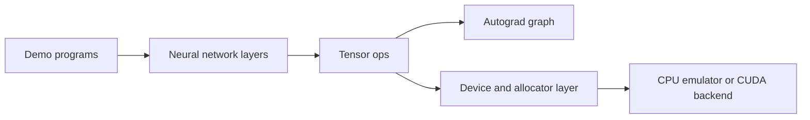

# SovereignGrad

SovereignGrad is a small C++17 deep learning playground built around a custom tensor core, reverse-mode autograd, neural network layers, and a lightweight optimizer stack. It supports a CPU path and an optional CUDA build when a local NVIDIA toolchain is available.

## What is in the box

- Tensor storage and shape utilities
- Reverse-mode autograd
- Core ops such as add, multiply, matmul, relu, sum, view, transpose, and device transfer
- Neural network layers including Linear, Conv2d, and BatchNorm2d
- An Adam optimizer
- Demo executables for synthetic digits, benchmarking, and MNIST-style training

## Architecture



## Repository layout

- `include/soverigngrad/` public headers for tensors, ops, autograd, and layers
- `src/` implementation files and demo entry points
- `.github/workflows/ci.yml` CI build that configures and runs the main demo in CPU emulation mode
- `CMakeLists.txt` project definition, packaging, and executable targets

## Build

```bash
cmake -B build -DCMAKE_BUILD_TYPE=Release -DUSE_CUDA=OFF
cmake --build build --config Release
```

If CUDA is available locally, you can leave `USE_CUDA` on and let CMake detect the compiler automatically.

## Run

```bash
./build/sovereign_grad
./build/sovereign_grad_benchmark
./build/mnist_demo
```

The main demo runs a small unit test suite, trains a synthetic 3-class classifier, and prints allocator and accuracy metrics as it goes.

## Notes

- The project is designed to build cleanly on CPU-only systems.
- The MNIST demo expects the standard IDX files in the working directory.
- The codebase currently favors clarity and explicit data movement over aggressive abstraction.
