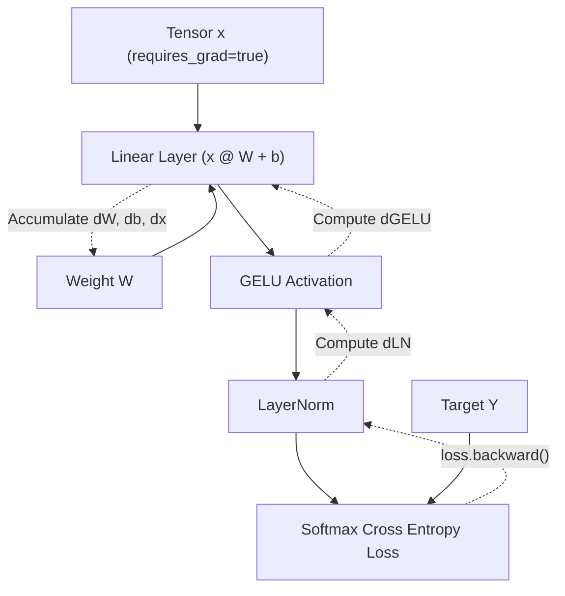

# SovereignGrad C++ API Reference Manual

**SovereignGrad** is a high-performance, standalone C++17 autograd and deep learning engine. This document provides a comprehensive reference for all core classes, namespaces, operators, modules, optimizers, memory systems, and utilities.

---

## Table of Contents
1. [Architecture & Namespaces](#1-architecture--namespaces)
2. [Tensor Core API](#2-tensor-core-api)
   - [Memory Model & Strides](#memory-model--strides)
   - [Constructors & Factory Methods](#constructors--factory-methods)
   - [Strided Views & Reshaping](#strided-views--reshaping)
   - [Mathematical Operators & Activations](#mathematical-operators--activations)
   - [Device Placement](#device-placement)
   - [Element Access & Telemetry](#element-access--telemetry)
3. [Autograd Engine](#3-autograd-engine)
   - [Graph Execution & `backward()`](#graph-execution--backward)
   - [In-Place Mutation Guard (`_version`)](#in-place-mutation-guard-_version)
   - [Context Guards (`NoGradGuard`)](#context-guards-nogradguard)
   - [Gradient Hooks](#gradient-hooks)
4. [Neural Network Module API (`sovereigngrad::nn`)](#4-neural-network-module-api-sovereigngradnn)
   - [Base Class: `nn::Module`](#base-class-nnmodule)
   - [Layers](#layers)
   - [Activation Layers](#activation-layers)
   - [Loss Functions](#loss-functions)
5. [Optimizers](#5-optimizers)
   - [`nn::AdamW`](#nnadamw)
   - [`nn::Adam`](#nnadam)
   - [`nn::SGD`](#nnsgd)
6. [Model Serialization (`sovereigngrad::serialization`)](#6-model-serialization-sovereigngradserialization)
7. [Memory Allocator (`MemoryAllocator`)](#7-memory-allocator-memoryallocator)
8. [Numerical Verification (`gradcheck`)](#8-numerical-verification-gradcheck)

---

## 1. Architecture & Namespaces

SovereignGrad symbols are organized under the following namespaces:

| Namespace | Description |
| :--- | :--- |
| `sovereigngrad` | Core tensor structures, autograd engine, mathematical operators, and memory management |
| `sovereigngrad::nn` | Neural network layers (`Linear`, `Conv2d`, `BatchNorm2d`, etc.), containers, and optimizers |
| `sovereigngrad::serialization` | High-speed binary `.sgrd` checkpoint serialization routines |
| `sovereigngrad::cuda` | Native CUDA kernel launch interfaces and device primitives |

---

## 2. Tensor Core API

### Memory Model & Strides

A `Tensor` in SovereignGrad is an $N$-dimensional multidimensional view over a shared memory `Storage` buffer.

- **Data Type**: `DType::Float32` (Single-precision IEEE 754 float)
- **Devices**: `Device::CPU`, `Device::CUDA`
- **Memory Layout**: Row-major contiguous strides by default; supports arbitrary non-contiguous strided slices.

```cpp
#include "sovereigngrad/tensor.hpp"
using namespace sovereigngrad;

// Create a 3D Tensor [batch=2, channels=3, dim=4]
Tensor x = Tensor::randn({2, 3, 4}, 0.0f, 1.0f, Device::CPU);

std::cout << "Shape: " << x.shape()[0] << "x" << x.shape()[1] << "x" << x.shape()[2] << "\n";
std::cout << "Total elements: " << x.numel() << "\n";
std::cout << "Is contiguous: " << (x.is_contiguous() ? "true" : "false") << "\n";
```

### Constructors & Factory Methods

```cpp
// 1. Uninitialized allocation
Tensor a({4, 16}, Device::CPU, /*requires_grad=*/false);

// 2. Scalar initialization
Tensor s(3.14159f, Device::CPU);

// 3. From vector data
std::vector<float> data = {1.0f, 2.0f, 3.0f, 4.0f};
Tensor b(data, {2, 2}, Device::CPU);

// 4. Factory: Zeros
Tensor z = Tensor::zeros({3, 3}, Device::CPU);

// 5. Factory: Ones
Tensor o = Tensor::ones({3, 3}, Device::CPU);

// 6. Factory: Constant full value
Tensor f = Tensor::full({3, 3}, 42.0f, Device::CPU);

// 7. Factory: Standard Normal Gaussian distribution (mean, stddev)
Tensor r = Tensor::randn({64, 128}, 0.0f, 1.0f, Device::CPU, /*requires_grad=*/true);

// 8. Factory: Uniform distribution [low, high)
Tensor u = Tensor::uniform({10, 10}, -1.0f, 1.0f, Device::CPU);
```

### Strided Views & Reshaping

SovereignGrad supports zero-copy $O(1)$ strided operations:

```cpp
Tensor t = Tensor::randn({2, 3, 4}, 0.0f, 1.0f);

// Transpose dimensions: zero-copy view with modified strides
Tensor t_trans = t.transpose(0, 1); // Shape: [3, 2, 4]

// Reshape / View: preserves storage
Tensor t_flat = t.view({2, 12}); // Shape: [2, 12]

// Ensure contiguous memory buffer if tensor became non-contiguous
Tensor t_contig = t_trans.contiguous();

// Detach from autograd DAG (stops gradient propagation)
Tensor detached = t.detach();

// Deep copy data & storage
Tensor cloned = t.clone();
```

### Mathematical Operators & Activations

All mathematical operators support automatic differentiation when `requires_grad = true`.

#### Elementwise Arithmetic
```cpp
Tensor c = a + b;     // Addition (supports broadcasting)
Tensor d = a - b;     // Subtraction
Tensor e = a * b;     // Elementwise multiplication (Hadamard)
Tensor f = a / b;     // Elementwise division
Tensor neg = -a;      // Unary negation
```

#### In-Place Arithmetic (Version Monitored)
```cpp
a.add_(b);          // a = a + b (increments a.version())
a.mul_(2.5f);       // a = a * 2.5f
```

#### Matrix Multiplication
```cpp
// Batched & 2D Matrix multiplication (C = A @ B)
// A: [M, K], B: [K, N] -> C: [M, N]
Tensor C = A.matmul(B);
```

#### Activation Functions
| Function | Formula | API Signature |
| :--- | :--- | :--- |
| **ReLU** | $\max(0, x)$ | `x.relu()` or `sovereigngrad::relu(x)` |
| **GELU** | $x \cdot \Phi(x) \approx 0.5x(1 + \tanh(\sqrt{2/\pi}(x + 0.044715x^3)))$ | `x.gelu()` or `sovereigngrad::gelu(x)` |
| **SiLU (Swish)** | $x \cdot \sigma(x) = \frac{x}{1 + e^{-x}}$ | `x.silu()` or `sovereigngrad::silu(x)` |
| **Sigmoid** | $\sigma(x) = \frac{1}{1 + e^{-x}}$ | `x.sigmoid()` or `sovereigngrad::sigmoid(x)` |
| **Tanh** | $\tanh(x) = \frac{e^x - e^{-x}}{e^x + e^{-x}}$ | `x.tanh()` or `sovereigngrad::tanh_op(x)` |
| **Exp / Log / Sqrt** | $e^x, \ln(x), \sqrt{x}$ | `x.exp()`, `x.log()`, `x.sqrt()` |
| **Power / Clamp** | $x^p, \min(\max(x, \text{min}), \text{max})$ | `x.pow(p)`, `x.clamp(min, max)` |
| **Dropout** | $\frac{x}{1-p} \cdot \text{Bernoulli}(1-p)$ | `x.dropout(p, training)` |

#### Reductions
```cpp
Tensor s_dim = x.sum(/*dim=*/1, /*keepdim=*/true);  // Sum along dimension
Tensor s_all = x.sum();                             // Global sum -> scalar Tensor
Tensor m_dim = x.mean(/*dim=*/0);                    // Mean along dimension
Tensor m_all = x.mean();                            // Global mean -> scalar Tensor
Tensor max_val = x.max(/*dim=*/1);                  // Maximum along dimension
```

### Device Placement

```cpp
// Transfer tensor buffer across PCIe bus between Host (CPU) and VRAM (CUDA)
Tensor x_gpu = x.to(Device::CUDA); // Or x.cuda()
Tensor x_cpu = x_gpu.to(Device::CPU); // Or x_gpu.cpu()
```

### Element Access & Telemetry

```cpp
float val = x.get_element({0, 2, 1}); // Read value at index
x.set_element({0, 2, 1}, 3.14f);      // Write value at index
float scalar = loss.item();           // Extract scalar from 1-element tensor
std::string summary = x.summary();    // Detailed string representation
x.print();                            // Print tensor to stdout
```

---

## 3. Autograd Engine

SovereignGrad utilizes a dynamically constructed Directed Acyclic Graph (DAG) for reverse-mode automatic differentiation.



### Graph Execution & `backward()`

```cpp
Tensor x = Tensor::randn({4, 8}, 0.0f, 1.0f, Device::CPU, /*requires_grad=*/true);
Tensor w = Tensor::randn({8, 2}, 0.0f, 1.0f, Device::CPU, /*requires_grad=*/true);

Tensor y = x.matmul(w);
Tensor loss = y.sum();

// Backpropagate gradients through the tape
loss.backward(/*retain_graph=*/false);

// Access gradients
Tensor grad_w = w.grad(); // Gradient tensor shape [8, 2]
Tensor grad_x = x.grad(); // Gradient tensor shape [4, 8]
```

### In-Place Mutation Guard (`_version`)

To prevent silent numerical gradient corruption caused by in-place modifications between forward and backward passes, SovereignGrad tracks an internal version counter on every `TensorImpl`:

```cpp
Tensor a = Tensor::randn({4, 4}, 0.0f, 1.0f, Device::CPU, true);
Tensor b = a.matmul(a);

a.add_(Tensor::ones({4, 4})); // Mutates 'a' in-place -> a.version() increments

// Throws std::runtime_error: "In-place modification detected: Tensor was modified after being used in forward pass."
b.sum().backward();
```

### Context Guards (`NoGradGuard`)

Disable autograd tape construction during evaluation or inference to eliminate graph memory allocations:

```cpp
{
    NoGradGuard no_grad;
    // Graph construction suppressed; memory freed immediately
    Tensor logits = model.forward(x);
}
// Autograd state automatically restored upon exiting scope
```

### Gradient Hooks

Register arbitrary callback functions to inspect or modify gradients during backpropagation:

```cpp
x.register_hook([](const Tensor& grad) {
    std::cout << "Gradient norm: " << grad.sum().item() << "\n";
    // Return modified gradient (e.g. gradient clipping)
    return grad.clamp(-1.0f, 1.0f);
});
```

---

## 4. Neural Network Module API (`sovereigngrad::nn`)

### Base Class: `nn::Module`

All neural network components inherit from `nn::Module`.

```cpp
#include "sovereigngrad/module.hpp"

class CustomBlock : public nn::Module {
public:
    std::shared_ptr<nn::Linear> fc;
    std::shared_ptr<nn::LayerNorm> ln;

    CustomBlock(int in_dim, int out_dim, Device dev = Device::CPU) {
        fc = std::make_shared<nn::Linear>(in_dim, out_dim, dev);
        ln = std::make_shared<nn::LayerNorm>(out_dim, 1e-5f, dev);

        // Register parameters and submodules for state_dict & parameter traversal
        register_module("fc", fc);
        register_module("ln", ln);
    }

    Tensor forward(const Tensor& x) {
        return ln->forward(fc->forward(x).gelu());
    }

    Tensor operator()(const Tensor& x) {
        return forward(x);
    }
};
```

#### Module Methods
- `parameters()`: Returns `std::vector<Tensor>` containing all trainable parameters recursively.
- `train(bool mode = true)`: Sets training mode (affects `Dropout` and `BatchNorm2d`).
- `eval()`: Convenience method for `train(false)`.
- `state_dict()`: Exports all named parameters into `std::unordered_map<std::string, Tensor>`.
- `load_state_dict(map, strict = true)`: Restores weights from a state dictionary.

---

### Layers

#### `nn::Linear`
Fully connected affine layer: $y = xW + b$.
```cpp
nn::Linear fc(int64_t in_features, int64_t out_features, Device device = Device::CPU);
```

#### `nn::Conv2d`
2D spatial convolution:
```cpp
nn::Conv2d conv(int64_t in_channels, int64_t out_channels, int64_t kernel_size, 
                int stride = 1, int padding = 0, Device device = Device::CPU);
```

#### `nn::BatchNorm2d`
Spatial batch normalization over $[N, C, H, W]$:
```cpp
nn::BatchNorm2d bn(int64_t num_features, float momentum = 0.1f, float eps = 1e-5f, Device device = Device::CPU);
```

#### `nn::LayerNorm`
Channels-last Layer Normalization:
```cpp
nn::LayerNorm ln(int64_t normalized_shape, float eps = 1e-5f, Device device = Device::CPU);
```

#### `nn::Dropout`
Randomly zeroes elements with probability $p$ during training:
```cpp
nn::Dropout drop(float p = 0.5f);
```

#### `nn::BatchNorm1d`
1D Batch Normalization over features `(N, C)` or `(N, C, L)`:
```cpp
nn::BatchNorm1d bn1d(num_features, /*momentum=*/0.1f, /*eps=*/1e-5f, dev);
```

#### `nn::MaxPool2d` & `nn::AvgPool2d`
Spatial 2D pooling operations:
```cpp
nn::MaxPool2d max_pool(/*kernel_size=*/2, /*stride=*/2, /*padding=*/0);
nn::AvgPool2d avg_pool(/*kernel_size=*/2, /*stride=*/2, /*padding=*/0);
```

#### `nn::Conv1d`
1D convolution over temporal / sequential channels:
```cpp
nn::Conv1d conv1(in_channels, out_channels, kernel_size, stride, padding, dev);
```

#### `nn::Embedding`
Dense lookup table for discrete indices / vocabulary:
```cpp
nn::Embedding emb(num_embeddings, embedding_dim, dev);
Tensor vectors = emb.forward(indices); // [Seq_Len, Embedding_Dim]
```

#### `nn::MultiheadAttention`
Pre-LayerNorm Scaled Dot-Product Self-Attention:
```cpp
nn::MultiheadAttention mha(embed_dim, num_heads, dev);
Tensor attended = mha.forward(sequence); // [Seq_Len, Embed_Dim]
```

#### `nn::Flatten`
Flattens dimensions into contiguous 2D feature vectors:
```cpp
nn::Flatten flatten(/*start_dim=*/1, /*end_dim=*/-1);
```

#### `nn::Sequential`
Container for chaining modules:
```cpp
nn::Sequential net(
    std::make_shared<nn::Conv2d>(1, 16, 3, 1, 1, dev),
    std::make_shared<nn::BatchNorm2d>(16, 0.1f, 1e-5f, dev),
    std::make_shared<nn::ReLU>(),
    std::make_shared<nn::MaxPool2d>(2, 2),
    std::make_shared<nn::Flatten>(1, -1),
    std::make_shared<nn::Linear>(16 * 14 * 14, 10, dev)
);
```

---

### Activation Layers
- `nn::ReLU`
- `nn::GELU`
- `nn::SiLU`
- `nn::Sigmoid`
- `nn::Tanh`
- `nn::Softmax`

---

### Loss Functions

#### `softmax_cross_entropy`
Numerically stable Softmax Cross Entropy loss with integrated log-sum-exp trick:
```cpp
Tensor loss = softmax_cross_entropy(logits, targets);
```

#### `nn::MSELoss`
Mean Squared Error: $\frac{1}{N}\sum (\hat{y} - y)^2$:
```cpp
nn::MSELoss mse;
Tensor loss_mse = mse.forward(pred, target);

nn::CrossEntropyLoss ce;
Tensor loss = ce.forward(logits, target);

---

## 5. Operator & Kernel Fusion

For memory-bound transformer workloads, SovereignGrad provides fused kernels that bypass intermediate tensor allocations:

```cpp
// 1. Fused Linear + GELU: combines GEMM, bias addition, and GELU activation
Tensor out = fused_linear_gelu(x, W, b);

// 2. Fused Add + LayerNorm: combines residual addition and normalization
Tensor norm_out = fused_add_layernorm(x, residual, gamma, beta, /*eps=*/1e-5f);

// 3. Fused Scaled Dot-Product Attention: memory-efficient self-attention
Tensor attended = fused_scaled_dot_product_attention(Q, K, V, scale);
```

---

## 6. Pre-Built Model Architectures (`sovereigngrad/models.hpp`)

SovereignGrad provides modern reference architectures ready for training and inference:

### `models::MiniResNet` & `models::ResNetBlock`
Deep residual convolutional network with skip connections:
```cpp
#include "sovereigngrad/models.hpp"

// Input: [Batch, 1, 28, 28] -> Output: [Batch, 10] logits
models::MiniResNet resnet(1, 10, Device::CPU);
Tensor logits = resnet.forward(images);
```

### `models::TransformerBlock` & `models::MiniGPT`
Pre-LayerNorm decoder-only transformer with scaled dot-product self-attention:
```cpp
#include "sovereigngrad/models.hpp"

// MiniGPT with 6 layers, 8 heads, 256 embedding dim, 50k vocab
models::MiniGPT gpt(50257, 1024, 256, 6, 8, Device::CPU);
Tensor logits = gpt.forward(token_ids, pos_ids);
```

---

## 7. Optimizers

Optimizers support both native GPU execution (zero-PCIe overhead) and optimized CPU loops.

### `nn::AdamW`
Decoupled weight decay Adam optimizer:
```cpp
nn::AdamW optimizer(model.parameters(), 
                   /*lr=*/0.001f, 
                   /*beta1=*/0.9f, 
                   /*beta2=*/0.999f, 
                   /*eps=*/1e-8f, 
                   /*weight_decay=*/0.01f);

optimizer.zero_grad();
loss.backward();
optimizer.step();
```

### `nn::Adam`
Standard Adam optimizer with $L_2$ weight decay set to 0.0:
```cpp
nn::Adam optimizer(model.parameters(), /*lr=*/0.01f);
```

### `nn::SGD`
Stochastic Gradient Descent with momentum and Nesterov accelerated gradient:
```cpp
nn::SGD optimizer(model.parameters(), 
                 /*lr=*/0.01f, 
                 /*momentum=*/0.9f, 
                 /*weight_decay=*/1e-4f, 
                 /*nesterov=*/true);
```

---

## 7. Model Serialization & Tooling

### C++ API (`sovereigngrad::serialization`)
High-performance binary format (`.sgrd`) for checkpointing weights and models.

```cpp
#include "sovereigngrad/serialization.hpp"

// Save model weights to file
serialization::save_module(model, "checkpoints/classifier_epoch_10.sgrd");

// Load model weights from file
serialization::load_module(model, "checkpoints/classifier_epoch_10.sgrd", /*strict=*/true);

// Save arbitrary state dictionary map
std::unordered_map<std::string, Tensor> state = { {"w", w}, {"b", b} };
serialization::save_checkpoint(state, "custom_state.sgrd");

// Load state dictionary
auto loaded_state = serialization::load_checkpoint("custom_state.sgrd", Device::CPU);
```

### Standalone CLI Tool (`sgrd-cli`)
Inspect, verify, and export `.sgrd` model checkpoint binary files:

```bash
# Display parameter inventory, tensor shapes, statistics, and byte counts
./build/sgrd-cli inspect model.sgrd

# Verify binary header, schema, and checksum integrity
./build/sgrd-cli verify model.sgrd

# Export checkpoint metadata to structured JSON
./build/sgrd-cli export-json model.sgrd model_metadata.json
```

---

## 8. Memory Allocator (`MemoryAllocator`)

SovereignGrad features a custom high-performance caching memory pool to minimize OS syscall overhead (`malloc`/`free`, `cudaMalloc`/`cudaFree`).

```cpp
#include "sovereigngrad/allocator.hpp"

auto& allocator = MemoryAllocator::instance();

// Print real-time memory telemetry
std::cout << allocator.get_memory_summary(Device::CPU) << "\n";

// Reset peak allocation tracking
allocator.reset_peak_memory_stats();

// Free all pooled buffers back to OS / GPU driver
allocator.release_all();
```

---

## 9. Numerical Verification (`gradcheck`)

Finite-difference numerical gradient checker for verifying autograd backpropagation correctness:

```cpp
#include "sovereigngrad/gradcheck.hpp"

// Define forward operator function
auto fn = [](const std::vector<Tensor>& inputs) -> Tensor {
    return inputs[0].matmul(inputs[1]).gelu().sum();
};

Tensor a = Tensor::randn({4, 4}, 0.0f, 1.0f, Device::CPU, true);
Tensor b = Tensor::randn({4, 4}, 0.0f, 1.0f, Device::CPU, true);

bool passed = gradcheck(fn, {a, b}, /*eps=*/1e-3f, /*atol=*/1e-2f);
assert(passed);
```
